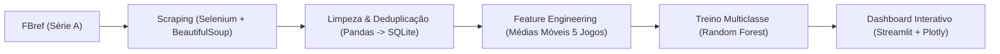
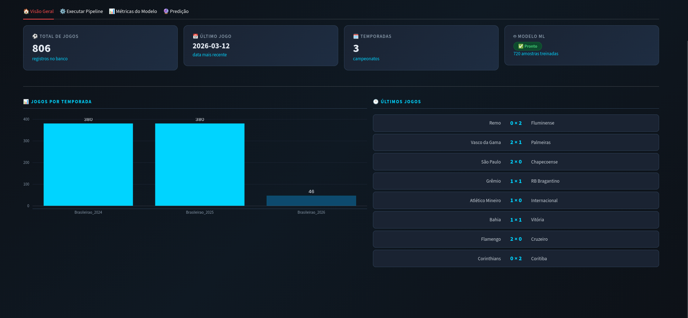
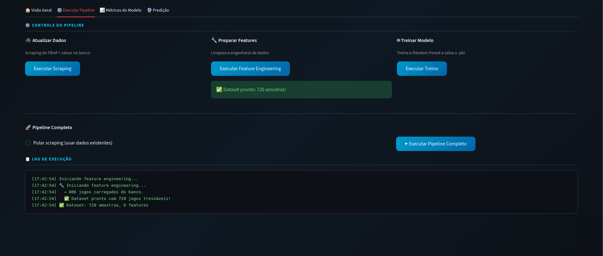
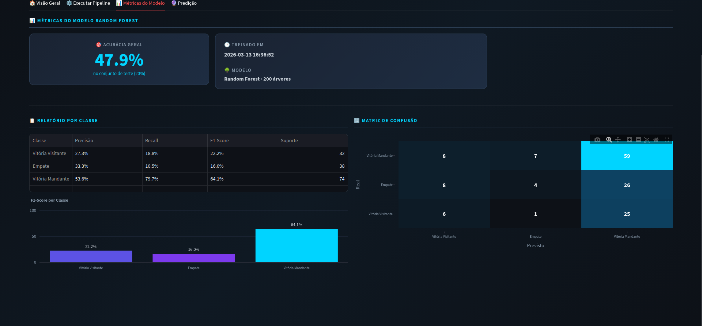
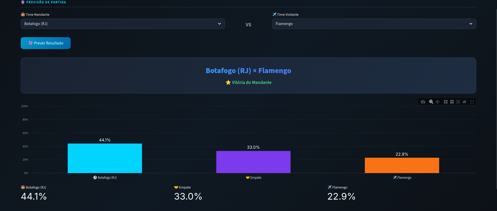

# Futproject.V1 — Pipeline End-to-End e Previsão Multiclasse do Brasileirão

> *End-to-end Data Science pipeline for Brazilian Série A match outcome prediction: automated scraping, SQLite storage, rolling feature engineering, Random Forest modeling, and interactive Streamlit/Plotly dashboard.*


---

## Contexto do Projeto

Prever resultados de futebol é um problema clássico de **classificação multiclasse sob alta variância** (*Vitória do Mandante*, *Empate* ou *Vitória do Visitante*). Este projeto implementa o ciclo completo de Ciência de Dados — da coleta automatizada em fontes web até a disponibilização de probabilidades em um dashboard interativo para exploração analítica.



---

## Principais Entregas Técnicas

- **Ingestão Automatizada (`src/scraper/`):** coleta de partidas históricas do Brasileirão Série A no [FBref](https://fbref.com/) com `Selenium` e `BeautifulSoup4`.
- **Persistência Sem Duplicatas:** consolidação incremental em banco relacional local (`SQLite`).
- **Engenharia de Atributos (`src/features/`):** cálculo de janelas móveis (*rolling features* dos últimos 5 jogos) capturando momento recente, pontos conquistados, saldo de gols feitos e gols sofridos.
- **Modelagem Multiclasse (`src/models/`):** classificador `Random Forest` (`Scikit-learn`) estimando a distribuição de probabilidades entre os 3 desfechos possíveis.
- **Orquestração & Visualização:** CLI unificada em `main.py` e aplicação analítica em `Streamlit` + `Plotly` com 4 visões (Visão Geral, Execução do Pipeline, Métricas de Avaliação e Simulador de Confrontos).

---

## Avaliação do Modelo e Considerações Metodológicas

- **Resultado obtido:** o classificador multiclasse alcança **47,9% de acurácia** nos três resultados possíveis (*Mandante*, *Empate*, *Visitante*).
- **Leitura técnica do resultado:**
  - Em uma distribuição teórica uniforme entre 3 classes equiprováveis (`1/3`), a probabilidade nominal é de `33,3%`; contudo, em campeonatos de pontos corridos o mando de campo altera a frequência histórica das classes, razão pela qual o dashboard acompanha também **F1-Score por classe** e **Matriz de Confusão** em vez de olhar apenas acurácia global.
  - O **empate** permanece como a classe de maior volatilidade estocástica, tornando a análise das probabilidades previstas por classe mais informativa do que um rótulo seco.

---

## Estrutura do Repositório

```text
Futproject.V1/
├── dashboard.py              # Dashboard interativo Streamlit (4 abas)
├── main.py                   # Pipeline CLI unificado (ingestão -> features -> treino -> predição)
├── requirements.txt
├── assets/                   # Capturas reais das telas do dashboard
└── src/
    ├── features/
    │   └── feature_engineering.py
    ├── models/
    │   ├── predict.py
    │   └── train.py
    └── scraper/
        ├── driver_factory.py
        └── parser.py
```

---

## Como Executar Localmente

```bash
git clone https://github.com/WnMoura/Futproject.V1.git
cd Futproject.V1

python -m venv .venv
# Windows:
.venv\Scripts\activate
# Linux / macOS:
source .venv/bin/activate

pip install -r requirements.txt
```

> **Pré-requisito para coleta ao vivo:** Google Chrome instalado (você também pode pular o scraping e rodar direto sobre o banco existente com `--skip-scraping`).

### Via Terminal (CLI)

```bash
python main.py                  # Pipeline completo (scraping + features + treino)
python main.py --skip-scraping  # Treina usando os dados já persistidos no SQLite
python main.py --predict        # Simulação interativa via terminal
```

### Via Dashboard Web

```bash
streamlit run dashboard.py
```

Acesse `http://localhost:8501`:

| Aba | Funcionalidade |
| :--- | :--- |
| Visão Geral | Total de jogos processados, série por temporada e últimos placares registrados |
| Pipeline | Execução modular ou completa das etapas com logs em tempo real |
| Métricas | Acurácia, F1-Score por classe e matriz de confusão interativa |
| Predição | Seleção de mandante/visitante com distribuição gráfica de probabilidades |

---

## Capturas do Dashboard

<details open>
<summary><b>Visualizar Telas do Dashboard</b></summary>

#### Visão Geral


#### Executar Pipeline


#### Métricas do Modelo


#### Predição de Confrontos

</details>

---

## Stack Utilizada

| Categoria | Tecnologias |
| :--- | :--- |
| Linguagem & Dados | `Python 3.12`, `Pandas`, `NumPy`, `SQLite3` |
| Machine Learning | `Scikit-Learn` (`RandomForestClassifier`), `Joblib` |
| Coleta Web | `Selenium`, `BeautifulSoup4`, `undetected-chromedriver` |
| Visualização & App | `Streamlit`, `Plotly` |

## Licença

Projeto desenvolvido para fins educacionais, portfólio e pesquisa aplicada em Ciência de Dados.
